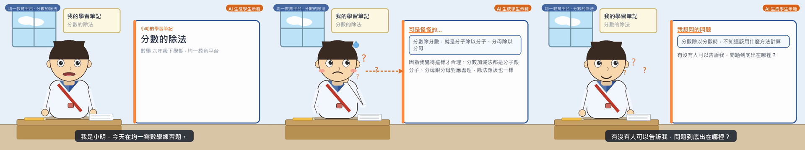

# AskBack AI Student

以台灣國小六年級學生「小明」的角色，模擬對**均一教育平台**學習單元的典型迷思與困惑提問，並自動產生語音、動畫與字幕，輸出一支完整的學生提問影片。

本專案只負責「學生迷思與提問」的呈現，**不產生** AI 教學設計師、教師端迷思診斷報告、正確答案或教師講解。



*左至右：單元引入、迷思推理中的困惑、最後的提問畫面（`python main.py all` 實際產出）*

## ✨ 功能特色

- **學生迷思模擬器**：內建 4 個六年級學習單元的迷思資料庫（卡關點、錯誤推理步驟、迷思陳述）
- **雙模式台詞生成**：`auto` 模式可選用 LLM 生成口語台詞；無金鑰時自動退回內建模板，保證輸出穩定
- **答案洩漏檢查**：自動偵測台詞中是否包含標準解答／正確解法字樣，觸發即退回模板
- **多供應商 TTS**：依序支援 OpenAI、Azure、edge-tts（免費）、本機 Windows SAPI，金鑰只從環境變數讀取
- **程式化 2D 動畫**：依每句台詞的場景與表情提示，以 Pillow 繪製角色動畫
- **完整媒體管線**：時間軸對齊 → 語音標準化 → SRT 字幕 → ffmpeg 合成 720p 影片
- **自動驗證與 manifest**：ffprobe 解碼、音量檢測、動態畫面抽樣、長度檢查（30–90 秒），並產出含 SHA-256 的生成清單

## 📦 系統需求

| 需求 | 說明 |
| --- | --- |
| Python 3.10+ | 建議使用虛擬環境 |
| ffmpeg / ffprobe | 必須在 `PATH` 中，用於音訊標準化、影片合成與驗證 |
| Windows + zh-TW 語音 | 僅在使用本機 `sapi` 引擎時需要 |
| 網路（可選） | 使用 edge / openai / azure TTS 或 LLM 模式時需要 |

## 🚀 快速開始

```bash
# 1. 安裝依賴
pip install -r requirements.txt

# 2. 複製環境變數範本（可留空，預設使用免費 edge-tts 或本機 SAPI）
cp .env.example .env   # Windows: copy .env.example .env

# 3. 執行完整管線（學生提問 → 語音 → 動畫 → 字幕 → 合成 → 驗證 → manifest）
python main.py all
```

輸出檔案位於 `output/`：

| 檔案 | 說明 |
| --- | --- |
| `student_question.json` | 學生迷思與提問資料（通過 JSON Schema 驗證） |
| `student_voice.wav` | 標準化後的語音（16-bit PCM WAV） |
| `student_subtitles.srt` | 與台詞逐句對應的字幕 |
| `student_animation.mp4` | 最終動畫影片（預設 1280×720 / 24 fps） |
| `generation_manifest.json` | 生成流程、環境資訊與檔案雜湊（不含任何金鑰） |

## 🎛️ CLI 指令

```bash
python main.py units                          # 列出可選學習單元與迷思
python main.py student                        # 只產生 student_question.json
python main.py tts                            # 只產生語音
python main.py all --unit sci-g6-circuit --mc 0 --provider edge
python main.py all --turns 3                  # 多輪互動（學生提問 + 後續回應）
python main.py verify --video output/student_animation.mp4
```

| 參數 | 說明 |
| --- | --- |
| `--unit` | 學習單元 ID（用 `python main.py units` 查看） |
| `--mc` | 該單元的第幾個卡關點（預設 0） |
| `--mode` | `auto` / `template` / `llm`（預設 auto：有金鑰用 LLM，否則內建資料庫） |
| `--turns` | 互動輪數（1 = 只有學生提問） |
| `--provider` | TTS 供應商：`auto` / `edge` / `openai` / `azure` / `sapi` |
| `--out` | 輸出目錄（預設 `output/`） |

## 📚 內建學習單元

| unit_id | 科目 | 單元 | 迷思類型 |
| --- | --- | --- | --- |
| `math-g6-frac-div` | 數學 | 分數的除法 | 規則誤用（分子分母分別相除） |
| `math-g6-negative` | 數學 | 正負數的大小比較 | 符號誤解（負號被當成標籤） |
| `sci-g6-circuit` | 自然與生活科技 | 串聯電路與並聯電路 | 直覺模型誤用（電流被消耗） |
| `math-g6-circle-area` | 數學 | 圓的周長與面積 | 公式混淆（周長與面積互換） |

## ⚙️ 環境變數

完整清單見 [`.env.example`](.env.example)，常用項目：

```ini
ASKBACK_TTS_PROVIDER=auto          # auto | edge | openai | azure | sapi
ASKBACK_TTS_VOICE=zh-TW-XiaoXiaoNeural
ASKBACK_TTS_RATE=2                 # 語速 -10 ~ 10

# 可選：LLM 台詞生成（留空即使用內建迷思資料庫）
ASKBACK_LLM_PROVIDER=none
ASKBACK_LLM_MODEL=gpt-4o-mini

# 動畫 / 影片輸出
ASKBACK_VIDEO_WIDTH=1280
ASKBACK_VIDEO_HEIGHT=720
ASKBACK_VIDEO_FPS=24
ASKBACK_TARGET_MIN=30              # 目標影片長度範圍（秒）
ASKBACK_TARGET_MAX=90
```

> ⚠️ 所有 API 金鑰只能從環境變數讀取，程式不會把金鑰寫入原始碼、JSON、日誌或 manifest。`.env` 已列入 `.gitignore`。

## 🗂️ 專案結構

```
askback-ai-student/
├── main.py                     # CLI 執行入口與完整管線
├── student_simulator/          # 學生迷思模擬器（角色、迷思資料庫、LLM、驗證）
├── tts_generator/              # 多供應商 TTS 引擎與音訊標準化
├── animation_generator/        # 場景腳本與 Pillow 2D 動畫渲染
├── media_pipeline/             # 時間軸、音訊組裝、字幕、合成與影片驗證
├── schemas/                    # student_question.json JSON Schema（Draft-07）
├── output/                     # 產出檔案（git 忽略，除範例檔外）
├── .env.example                # 環境變數範本
└── requirements.txt            # Python 依賴
```

## 🛡️ 安全與品質設計

- **答案洩漏防護**：台詞生成後會對照 `forbidden_answer_terms`（正確答案／正解／解答是…）逐項檢查，LLM 輸出觸發時自動退回模板
- **Schema 驗證**：`student_question.json` 必須通過 `schemas/student_question.schema.json` 驗證，且台詞數與動畫提示數一致
- **非空白音訊保證**：TTS 輸出會解碼檢查，絕不回傳空白音訊冒充成功
- **影片驗證**：完整解碼、音量統計、相鄰畫面差異抽樣（確認非靜態圖）、長度落在 30–90 秒
- **供應鏈容錯**：TTS 依序嘗試各供應商，每個引擎獨立回報明確錯誤（不含金鑰），全部失敗才拋錯

## 📄 免責聲明

本專案輸出為 **AI 生成學生示範**，僅用於呈現學生的迷思、困惑與提問，並非真實學生紀錄，也不是教學示範答案或正確解法。

## 📄 License

MIT
